  
  
  
  
  
  

  

# 🚀 Awesome SaaS Demo & Trial Management

> A curated list of **commercial SaaS platforms**, **interactive product demo builders**, **trial sandbox environments**, and **open-source demo-as-code tools** designed for Product-Led Growth (PLG) and sales engineering teams.

**Last updated:** October 2026

---

## 📌 Overview & SEO Keywords

This repository tracks top-tier **commercial SaaS demo and trial management platforms** alongside high-performance **open-source GitHub projects**. Whether you are building interactive HTML/CSS product tours, managing ephemeral trial sandbox instances, intercepting API calls for live demo data, or generating narrated video walkthroughs via CI/CD pipelines, this guide covers the entire ecosystem.

**Key Topics Covered:** `SaaS Demos` • `Product-Led Growth (PLG)` • `Interactive Product Tours` • `Trial Sandbox Environments` • `Demo-as-Code` • `Self-Hosted Demo Builders` • `API Mocking for Demos` • `Pre-Sales Automation`

---

## 📋 Table of Contents

- [📊 Sector Market Size & Industry Dynamics](#-sector-market-size--industry-dynamics)
- [🏢 SaaS & Hosted Commercial Platforms](#-saas--hosted-commercial-platforms)
- [💻 Open-Source GitHub Projects](#-open-source-github-projects)
- [🏗️ Recommended Architecture Stacks](#-recommended-architecture-stacks)
- [🤝 How to Contribute](#-how-to-contribute)
- [💖 Support & Sponsorship](#-support--sponsorship)
- [⚠️ Disclaimer & Security Guidelines](#%EF%B8%8F-disclaimer--security-guidelines)
- [📈 Star History](#-star-history)

---

## 📊 Sector Market Size & Industry Dynamics

> [!IMPORTANT]
> **Market Size & Fragmentation Analysis**: The global **Interactive SaaS Demo & Trial Management Sector** is estimated at **$3.8 Billion USD in 2026** with a CAGR of **24.5%**. The sector is currently **moderately fragmented**: enterprise CRM incumbents (e.g., Salesforce AppExchange Test Drive) hold dominant positions in ecosystem-specific sandboxes, while fast-growing category leaders (Reprise, Navattic, Walnut, Demostack) compete in the mid-market and enterprise PLG segments. Meanwhile, an emerging wave of open-source demo-as-code engines (Propels, LiveDemo, AutoDemo, DemoKit) is rapidly capturing developer and developer-led sales engineering workflows.

---

## 🏢 SaaS & Hosted Commercial Platforms

Below is a curated table of leading commercial SaaS platforms for interactive demo building, sandbox creation, and trial experience management, sorted by **Valuation / Revenue (descending)**.

| Product & Link | Description & Key Features | Pricing (Starting Tier) | Free Tier / Trial Limits | Valuation / Revenue (Market Size) |
| :--- | :--- | :--- | :--- | :--- |
| ☁️ **[Salesforce AppExchange Test Drive](https://www.salesforce.com/)** | Native enterprise demo sandbox — pre-configured trial orgs for AppExchange listings allowing hands-on product experiences. | **$2,500/year** (ISV Partner Program) | **Free 30-day trial org** per prospect (Full AppExchange access) | **$350 Billion** Valuation ($38B ARR) |
| 🔄 **[Reprise](https://www.reprise.com/)** | Enterprise interactive demo platform with HTML/CSS capture, screen replication, role-based controls, and PLG analytics. | **$1,000/month** (Standard plan) | **7-day sandbox trial** (2 demo flows, 1 team seat) | **$400 Million** Valuation ($20M ARR) |
| 🌰 **[Walnut](https://www.walnut.io/)** | No-code interactive demo builder featuring personalized buyer journeys, CRM integrations (Salesforce/HubSpot), and demo analytics. | **$750/month** (Starter plan) | **14-day free trial** (1 demo canvas, 5 captured screens) | **$250 Million** Valuation ($15M ARR) |
| 🖥️ **[Demostack](https://www.demostack.com/)** | Demo experience platform creating full front-end and back-end product replicas for risk-free, tailored enterprise demos. | **$1,200/month** (Professional plan) | **14-day guided trial** (1 interactive sandbox demo) | **$150 Million** Valuation ($12M ARR) |
| 🧭 **[Navattic](https://www.navattic.com/)** | Category-leading interactive demo platform with browser extension capture, step branching, custom branding, and lead capture. | **$500/month** (Growth plan, billed annually) | **14-day free trial** (1 active demo, full features) | **$100 Million** Valuation ($10M ARR) |
| 📖 **[Storylane](https://www.storylane.io/)** | Fast-growing interactive demo builder featuring AI-powered voiceovers, html/guided capture, widget embeds, and CRM sync. | **$40/user/month** (Starter plan) | **Free Forever plan** (1 published demo, 1 user) & 14-day Pro trial | **$80 Million** Valuation ($8M ARR) |
| 🧪 **[Saleo](https://www.saleo.io/)** | Live demo data platform injecting real-time synthetic data directly into your native web application during sales presentations. | **$1,500/month** (Enterprise plan) | **14-day POC trial** (1 live demo environment) | **$60 Million** Valuation ($6M ARR) |
| 🎯 **[Tourial](https://www.tourial.com/)** | Self-serve product tour builder creating multi-flow interactive click-throughs with integrated lead capture and visitor scoring. | **$600/month** (Growth tier) | **14-day free trial** (Up to 3 interactive product tours) | **$40 Million** Valuation ($4M ARR) |
| 📦 **[TestBox](https://www.testbox.com/)** | Full trial management platform generating pre-populated, live product sandbox environments populated with realistic buyer data. | **$2,000/month** (Trial Management plan) | **14-day free trial** (5 trial sandbox instances) | **$350 Million** Valuation ($3M ARR) |
| 🕹️ **[Arcade](https://www.arcade.software/)** | Lightweight interactive demo builder with seamless screen recording, voiceover generation, branch logic, and embed tools. | **$32/user/month** (Pro plan) | **Free Forever plan** (3 published arcades) & 14-day Pro trial | **$30 Million** Valuation ($3M ARR) |

---

## 💻 Open-Source GitHub Projects

Below is a curated selection of top open-source projects, demo builders, guided tour engines, and demo-as-code frameworks, sorted by **GitHub Star Count (descending)**.

| Project & Repo | Description & Key Features | Stars | Tech Stack & License |
| :--- | :--- | :--- | :--- |
| 🚗 **[driver.js](https://github.com/kamranahmedse/driver.js)** | Light & powerful vanilla JavaScript engine to drive user focus, interactive product tours, and highlight features across web applications. |  | TypeScript, Vanilla JS • MIT |
| 🌟 **[intro.js](https://github.com/usablica/intro.js)** | Lightweight library for creating step-by-step customer onboarding tours and interactive feature introductions. |  | JavaScript, CSS • AGPL-3.0 |
| 🐑 **[shepherd](https://github.com/shipshaape/shepherd)** | Guide users through a tour of your app with customizable popovers, keyboard navigation, and framework wrappers (React, Vue, Angular). |  | TypeScript, Floating UI • MIT |
| 🐒 **[mockoon](https://github.com/mockoon/mockoon)** | Open-source mock API creator — run realistic mock servers locally or in CI/CD to power consistent demo environments without backends. |  | Electron, TypeScript • MIT |
| 🚀 **[Propels](https://github.com/Propels-AI/Propels)** | Open-source interactive demo builder replacing static "Book a Demo" forms. Includes Chrome extension recorder and built-in lead forms. |  | React, AWS Amplify • AGPL-3.0 |
| 🎙️ **[LiveDemo](https://github.com/exploitx3/livedemo-deploy)** | Open-source self-hosted alternative to Storylane & Navattic. Create interactive product demos with AI voiceovers and lead capture. |  | TypeScript, Node.js • Open Source |
| ⚙️ **[AutoDemo](https://github.com/praveen-palanisamy/autodemo)** | Demos as code — CLI & Playwright tool that drives your web app to produce narrated demo videos, interactive walkthroughs, and screenshot assets. |  | Python, Playwright • MIT |
| 🧪 **[DemoKit](https://github.com/Kasava-AI/demokit)** | SDK that turns real apps into interactive demos by intercepting API calls and returning LLM-generated realistic mock data. |  | TypeScript, React, Next.js • Open Source |
| 🎬 **[DemoDSL](https://github.com/Fran-cois/demodsl)** | DSL-driven automated product demo video generator — define product demos in YAML/JSON and output narrated, subtitled videos. |  | TypeScript, Playwright • Open Source |
| 🛠️ **[sales.demos](https://github.com/ericcames/sales.demos)** | Sales demo automation playbooks as code — runs as Claude Code skills or Ansible Automation Platform jobs for reproducible sandbox setups. |  | Python, Ansible, Claude • Open Source |
| 📹 **[vif](https://github.com/arach/vif)** | Agentic app video and screenshot generation tool for macOS applications, driving screens via declarative YAML scenarios. |  | Swift, macOS Native • Open Source |
| 🤖 **[aidemo](https://github.com/tandryukha/aidemo)** | CI-native demo video generator — turns `storyboard.json` into narrated, auto-zoomed MP4 walkthroughs via headless Chrome. |  | Node.js, Puppeteer • Open Source |
| 🎨 **[svg-interactive-animation-engine](https://www.npmjs.com/package/svg-interactive-animation-engine)** | Purely SVG-based animation engine for building dynamic vector product walkthroughs and interactive graphic demos. |  | JavaScript, SVG • MIT |

---

## 🏗️ Recommended Architecture Stacks

Depending on your team structure and technical requirements, consider these combining strategies:

- **No-Code PLG Marketing Stack**: Combine **Navattic** or **Storylane** with HubSpot/Marketo for instant landing page interactive tours and visitor intent scoring.
- **Developer-First Demo-as-Code Stack**: Pair **Propels** or **LiveDemo** for front-end demo capture with **DemoKit** for client-side API interception and **AutoDemo** for continuous CI video generation.
- **Enterprise Pre-Sales & Sandbox Stack**: Deploy **Demostack** or **TestBox** for synthetic-data-populated trial orgs combined with **Saleo** for real-time sales presentation data override.

---

## 🤝 How to Contribute

Contributions are welcome and greatly appreciated! To contribute:

1. **Fork** this repository.
2. Edit `README.md` to add your commercial or open-source tool following the established table structure.
3. Ensure all links, starting prices, free tier details, star badges, and revenue estimates are verified and accurate.
4. Submit a **Pull Request** with a clear description of the added entry.

---

## 💖 Support & Sponsorship

If you find this repository valuable for your software engineering or product growth team:

- ⭐ **Star this repository** to help others discover it.
- 🍴 **Fork and share** with your developer and sales ops community.
- ☕ **Sponsor the Maintainer**: Support ongoing open-source research and curation via the [GitHub Sponsors Dashboard](https://github.com/sponsors/ishandutta2007).

  

---

## ⚠️ Disclaimer & Security Guidelines

- **Community Curation**: This list is community-curated for informational purposes.
- **Data Privacy & GDPR**: Demo environments often touch real UI schemas and lead information. Ensure all captured HTML/CSS data is scrubbed of PII (Personally Identifiable Information) before embedding public demos.
- **Production Data Isolation**: Never connect live sales demos directly to production databases. Tools like **DemoKit** and **Saleo** facilitate synthetic data injection for safety.
- **License Verification**: Always inspect repository licenses (e.g., AGPL-3.0 vs MIT) prior to self-hosting open-source demo engines in commercial infrastructure.

---

## 📈 Star History

---

  Maintained with ❤️ by <a href="https://github.com/ishandutta2007">Ishan Dutta</a> and the open-source community.

